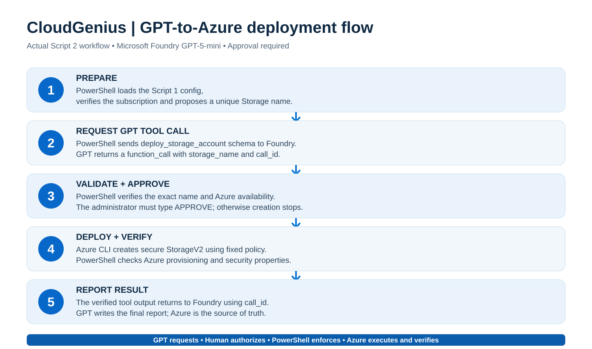

# CloudGenius AI Azure Administrator

AI-powered Azure infrastructure administration using Microsoft Foundry, GPT function calling, PowerShell, and Azure CLI. Demonstrates human-approved infrastructure deployment, security enforcement, and automated resource verification.

> **Status:** Working proof of concept, not a production autonomous administrator. Tested successfully in Windows PowerShell / VS Code on 2026-10-16. Deploying resources can incur Azure charges.

## 🚀 Project overview — AI-powered Azure administration

CloudGenius demonstrates an **AI-assisted Azure infrastructure provisioning proof of concept** built with **Microsoft Foundry, GPT-5-mini, PowerShell and Azure CLI**.

### 🎯 What the project demonstrates

- **AI function calling** to request a defined Azure infrastructure operation.
- **Secure Azure Storage Account provisioning** through an approved PowerShell/Azure CLI executor.
- **Human-in-the-loop approval** before a change is made.
- **Automated security enforcement** using fixed storage configuration requirements.
- **Independent verification** against the actual Azure resource state.
- **AI-generated deployment reporting** based on the verified results returned to the model.

### 🧠 What Microsoft Foundry did — specifically

Microsoft Foundry hosted the **GPT-5-mini** model deployment and made it available through the Responses API. During the storage workflow, GPT-5-mini:

1. **Processed** a predefined request to provision a secure Storage Account.
2. **Emitted** a structured `deploy_storage_account` function call with the requested storage name.
3. **Received** the real provisioning and security verification result from the external PowerShell executor.
4. **Generated** a final natural-language report using that result.

**Execution boundary:** Foundry/GPT **did not create the Storage Account directly**, execute Azure CLI, select the security configuration, or authorize the operation. PowerShell validated the function call and required the operator to type `APPROVE`; **Azure CLI and Azure Resource Manager** performed the creation. PowerShell then independently verified the resulting security properties.

### 🔁 End-to-end workflow

```text
Administrator runs Script 2
  → PowerShell sends a predefined storage request to Foundry GPT-5-mini
  → GPT emits deploy_storage_account(storage_name)
  → PowerShell validates arguments and checks storage name availability
  → Administrator types APPROVE
  → Azure CLI / Azure Resource Manager creates the secure Storage Account
  → PowerShell verifies provisioning and security settings in Azure
  → Verified function_call_output is returned to GPT-5-mini
  → GPT produces a final deployment report
```

### 🔐 Security and governance

The executor enforces **HTTPS-only access, TLS 1.2 minimum, disabled anonymous blob access, disabled public network access and disabled Shared Key authentication**. These are code-enforced controls—not security decisions delegated to the AI model. The lab does not provision the private connectivity required to access storage data.

### 🏆 Key achievement

**The proof of concept integrates generative AI function calling with real Azure administration while retaining human approval, deterministic infrastructure execution, security enforcement and verifiable reporting.**

This is **direct function calling, not an MCP server or a fully autonomous Foundry agent**. Its storage request and allowed operation are deliberately predefined. The repository implements this workflow; live success in a particular subscription must be established from its Azure verification output.

## What this repository provides

Two scripts that implement the complete, reproducible demonstration:

| Order | Script | What it does |
| --- | --- | --- |
| 1 | [01-Deploy-CloudGeniusFoundry.ps1](scripts/01-Deploy-CloudGeniusFoundry.ps1) | Creates/verifies the resource group, VNet, subnet, Microsoft Foundry AIServices account, Foundry project and GPT-5-mini deployment; saves non-secret local configuration |
| 2 | [02-GPT-Deploy-SecureStorage.ps1](scripts/02-GPT-Deploy-SecureStorage.ps1) | Sends a tool definition and deployment request to GPT, validates GPT's function call, asks for your explicit approval, executes a secure Azure CLI storage deployment, independently verifies the resource and sends the result back to GPT |

**Important distinction:** GPT *requested* the operation by emitting a function call. GPT did **not** execute Azure CLI or directly create Azure resources. PowerShell is the trusted execution/approval boundary; Azure Resource Manager actually provisions the resource.

## Prerequisites

- Windows PowerShell 5.1+ or PowerShell 7+; Visual Studio Code with a PowerShell terminal is optional.
- [Azure CLI](https://learn.microsoft.com/cli/azure/install-azure-cli) installed; confirm with `az version`.
- Sign in interactively: `az login`.
- Permission to create resource groups, networks, Microsoft.CognitiveServices AIServices resources/projects/model deployments, Storage accounts and to list Foundry account keys.
- A subscription with GPT-5-mini **GlobalStandard** quota in East US. The demonstrated environment had capacity 10 (10,000 tokens/minute), but quota/availability depend on your subscription.
- **Configure your own subscription ID** at the top of Script 1 before running. The committed sample ID is the original demonstration subscription, **not** a shared subscription you can deploy to. Script 2 reads the ID from the JSON file created by Script 1.
- Azure resources incur costs. Review usage and clean up after the demo.

## Quick start — copy, configure and run

In PowerShell:

~~~powershell
git clone https://github.com/globalcloudgenius/cloudgenius-ai-azure-administrator.git
cd cloudgenius-ai-azure-administrator
az login
~~~

Open `scripts/01-Deploy-CloudGeniusFoundry.ps1` and replace the `$SubscriptionId` value with **your own** Azure subscription ID. Check region, naming and requested quota before continuing.

Run **Script 1**:

~~~powershell
& ".\scripts\01-Deploy-CloudGeniusFoundry.ps1"
~~~

After `SUCCESS: Azure/Foundry environment verified` appears, run **Script 2**:

~~~powershell
& ".\scripts\02-GPT-Deploy-SecureStorage.ps1"
~~~

When Script 2 displays the resource name, region and security settings, it waits for the literal confirmation **APPROVE**. Without it, no storage creation command is executed.

### Script execution policy

If you receive `cannot be loaded ... not digitally signed`, inspect the scripts and their source first. For downloaded scripts you trust, run:

~~~powershell
Get-ChildItem ".\scripts\*.ps1" | Unblock-File
~~~

If an authorized local environment still blocks them, a temporary **process-scoped** policy may help (organization-managed policy can still override it):

~~~powershell
Set-ExecutionPolicy -Scope Process -ExecutionPolicy Bypass -Force
~~~

Never globally weaken an organization's script execution controls.

## Expected Azure resource configuration

| Resource / setting | Value |
| --- | --- |
| Resource group | `rg-cloudgenius-ai-dev` |
| Region | `eastus` |
| VNet | `vnet-cloudgenius-ai`, `10.50.0.0/16` |
| Reserved subnet | `snet-ai-private-endpoints`, `10.50.1.0/24` |
| Foundry resource | Generated unique name, e.g. `cgfoundry170463` |
| Foundry project | `cloudgenius-ai-project` |
| Model deployment | `cg-gpt-5-mini` |
| Model | `gpt-5-mini`, version `2025-08-07`, GlobalStandard, capacity 10 |
| Storage name | Generated unique name, e.g. `cgaistore610655` |
| Storage SKU/type | `Standard_LRS` / `StorageV2` |
| HTTPS only | `true` |
| Minimum TLS | `TLS1_2` |
| Allow anonymous blob access | `false` |
| Public network access | `Disabled` |
| Allow Shared Key authentication | `false` |

**Storage is not usable over the public endpoint** with public network access disabled. The reserved subnet is created by Script 1, but **no Private Endpoint, Private DNS integration, VNet client, or Storage Blob Data RBAC is deployed** in this proof of concept.

## Documentation

- [Foundation deployment — step-by-step command and variable explanations](docs/01-foundation-walkthrough.md)
- [GPT deployment — detailed function calling, approval, verification and tool response](docs/02-gpt-storage-walkthrough.md)
- [Security model, troubleshooting and operational notes](docs/03-security-operations.md)

## Deployment architecture

~~~text
Windows administrator / VS Code PowerShell
    |
    | Script 1: Azure CLI with signed-in administrator
    v
Azure Resource Manager
    +-- Resource Group / Virtual Network / Subnet
    +-- Microsoft Foundry AIServices / Project
    +-- GPT-5-mini deployment

Windows administrator / VS Code PowerShell
    |
    | Script 2: HTTPS request to Foundry Responses API
    v
GPT-5-mini
    |
    | returns function_call: deploy_storage_account
    | arguments: {"storage_name":"cgaistore..."}
    v
Local PowerShell executor
    +-- validates GPT-requested name matches approved candidate
    +-- checks global name availability
    +-- prompts human to type APPROVE
    +-- executes fixed-policy az storage account create
    +-- reads Azure resource and verifies all security values
    |
    | function_call_output includes actual verified Azure result
    v
GPT-5-mini -> final narrative report
~~~

## Independent verification

After Script 2 succeeds, retrieve the generated name from its console output, then run (replace the name with your own):

~~~powershell
az storage account show --name cgaistore610655 --resource-group rg-cloudgenius-ai-dev --query "{Name:name,State:provisioningState,HTTPS:enableHttpsTrafficOnly,TLS:minimumTlsVersion,AnonymousBlob:allowBlobPublicAccess,PublicNetwork:publicNetworkAccess,SharedKey:allowSharedKeyAccess}" --output json
~~~

Expected: `Succeeded`, `true`, `TLS1_2`, `false`, `Disabled`, `false`. Azure's actual API response is authoritative—not the model's prose.

## Safe repository usage and limitations

- **Do not commit** `cloudgenius-ai-config.json` if it contains environment identifiers you prefer to keep private; it contains no API key, but does contain subscription/resource metadata. It is gitignored by default.
- Never commit API keys, access tokens, credentials or full console transcripts that might contain secrets.
- Script 1 **does not delete or overwrite** existing infrastructure; it checks expected configuration where implemented. Script 2 intentionally generates a fresh storage name each run.
- Re-running Script 2 **creates another chargeable storage account** after approval; it is not storage-creation-idempotent.
- Original proof-of-concept authenticates Foundry calls with a locally retrieved account key and executes Azure CLI under your active `az login` permissions. Prefer managed identity, least-privilege RBAC, auditable approvals and credential-free inference for production.
- No fully hosted Foundry Agent Service agent is created; these are direct model tool calls orchestrated from PowerShell.
- Source history remains in GitHub; do not upload secrets, even if you later delete them.
- To remove demo resources, follow the Azure portal's resource group deletion flow **only after validating the group contains nothing important**. Deletion is irreversible for active resources. Foundry soft-delete/purge may require a separate authorized action.

## Learning outcomes

After a successful run you can explain the difference between **function declaration**, **model-generated function call**, **local function executor**, **human approval**, **Azure control-plane operation**, **independent verification** and **function-call output returned to the model**.

## Useful Microsoft documentation

- [Azure CLI documentation](https://learn.microsoft.com/cli/azure/)
- [Azure Storage security recommendations](https://learn.microsoft.com/azure/storage/common/security-recommendations)
- [Azure AI model inference and function calling](https://learn.microsoft.com/azure/ai-foundry/)
- [Azure Private Endpoint for Storage](https://learn.microsoft.com/azure/storage/common/storage-private-endpoints)

## License

No license is assigned by this README. All rights reserved unless the repository owner explicitly adds a license.


## Standard operating procedure, architecture and value

This POC is supported by **project-specific** operating documentation and two GitHub-rendered Mermaid diagrams. These describe the **actual tested configuration**, not an imagined production system.

- [SOP-CG-AI-001 — Deploy, approve, verify and handle failures](docs/SOP-CloudGenius-AI-Azure-Administrator.md): run prerequisites, operator decision points, security gates, evidence and error handling.
- [As-built Azure topology](diagrams/01-deployed-azure-topology.md): subscription, `rg-cloudgenius-ai-dev`, VNet/subnet, Foundry/project/model, Storage, and management/inference boundaries. Explicitly shows the *missing* private endpoint.
- [Exact GPT function-call sequence](diagrams/02-function-calling-sequence.md): GPT function-call arguments, local approval, Azure CLI creation, independent verification and model tool-result roundtrip.
- [Why this matters — practical benefits and future use cases](docs/04-business-value-and-use-cases.md): demonstrates safe AI/tool boundaries for administrators, architects and learners, plus clearly labeled future production improvements.

**Core value:** GPT structures the operator's request, but cannot set arbitrary Azure CLI flags or grant itself approval. PowerShell enforces a defined deployment policy and Azure's actual state is checked before the AI writes its success report.


## Decommission the lab safely

A separate, **approval-gated** PowerShell cleanup script is available:

- [Script 3 — Decommission CloudGenius AI](scripts/03-Decommission-CloudGeniusAI.ps1)
- [Decommission SOP, verification and important warnings](docs/05-decommission-sop.md)

From a clone that contains the local configuration generated by Script 1:

~~~powershell
& ".\\scripts\\03-Decommission-CloudGeniusAI.ps1"
~~~

This inventories the group, verifies the subscription, asks for the exact resource-group deletion confirmation, deletes **all** resources in that group, and checks for a matching soft-deleted Foundry account. It separately asks whether to **PURGE** that account. If you no longer have the config file, supply explicit subscription, RG, region and Foundry-name parameters as shown in the SOP.

> **WARNING:** Decommissioning is irreversible for many resources. It affects **everything in the group**, even resources added later. It does not erase billing history or retained Azure logs. It does not delete GitHub files.

## Executive presentation

The project also has a 10-slide executive/technical PowerPoint covering the architecture, implementation, security controls, function-call demonstration, SOP, business value and production-readiness gaps. The presentation should be distributed as an editable `.pptx`; do not substitute the text of a slide deck for the original PowerPoint file.


## Visual diagrams (GitHub-rendered SVG)

These are actual **static vector diagrams**, not Mermaid code. They display directly in GitHub and remain sharp when zoomed.

### 1. As-built Azure topology


[View topology with technical notes](diagrams/01-deployed-azure-topology.md)

### 2. Five-step GPT to Azure flow



[View execution flow with detailed explanation](diagrams/02-function-calling-sequence.md)

The earlier Mermaid rendering error is resolved by linking real SVG illustrations. These diagrams reflect the scripts' observed workflow, not a hosted autonomous agent or deployed Private Endpoint.
