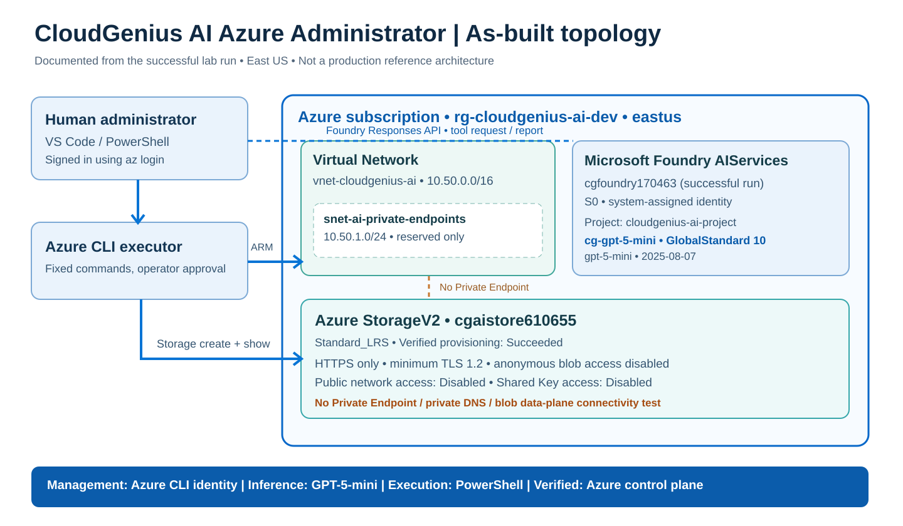

# Actual deployed Azure topology — CloudGenius AI Azure Administrator

This is a **resource and trust-boundary view of the scripts as written**, **not** a planned production system. Example names `cgfoundry170463` and `cgaistore610655` were confirmed in the October 16, 2026 successful run. New runs generate different names.

## Interpretation
- **Management plane:** The local user's Azure CLI identity creates and queries resources through Azure Resource Manager. The model has **no subscription login**.
- **Inference plane:** Script 2 calls the Foundry resource's HTTPS Responses API using an account key obtained locally at runtime. Foundry hosts GPT-5-mini; the model can return a **function call request**, not execute Azure CLI.
- **Network plane:** A VNet and named subnet exist, but they are **not connected to the Storage account**. The dashed line explicitly indicates missing private endpoint and private DNS; therefore this demo does **not** prove private blob connectivity.
- **Data plane:** No blob upload, download, application access or Entra Blob Data RBAC test occurs.
- **Identity boundary:** The Foundry account has a system-assigned identity, but that identity is not used by the local executor.
- **Scale:** The foundry deployment requested capacity 10 (10,000 TPM) in the example; requests and pricing depend on actual subscription limits.

See the [execution sequence](02-function-calling-sequence.md) for what the AI actually did.
